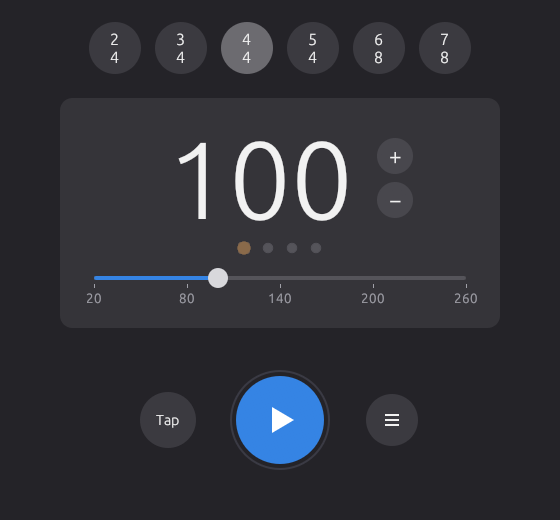
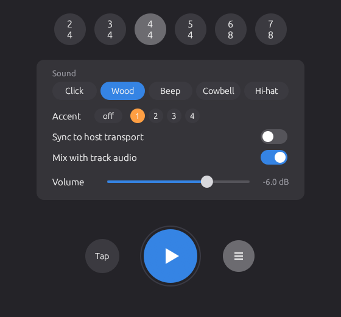

# Metro

[Wersja polska](README.pl.md)

A simple metronome **VST3 / CLAP** plugin for Linux (Ardour, Reaper and others), written in Rust
with [nih-plug](https://github.com/robbert-vdh/nih-plug) and egui. It also runs as a standalone app.

<p>
  
  
</p>

## Features

- meters: 2/4, 3/4, 4/4, 5/4, 6/8, 7/8
- tempo 20–260 BPM: slider, +/− buttons, mouse wheel, **Tap** tempo
- 5 synthesized sounds: Click, Wood, Beep, Cowbell, Hi-hat
- **accent on any beat** (click a beat dot or use the buttons in the options), or no accent at all
- **sync to host transport**: the click starts with playback/recording and follows the project
  tempo and bar grid (in x/8 meters it clicks on every eighth note)
- **mix with track audio**: when on, the click is added to the track's signal; when off, the
  plugin outputs the click only and the track's own audio is muted
- all settings are plugin parameters, so they are saved with the project and can be automated
- English and Polish UI, picked from the system locale (`LC_ALL` → `LC_MESSAGES` → `LANG`);
  override with `METRO_LANG=en` or `METRO_LANG=pl`

## Building and installing

Requires Rust (stable).

```sh
cargo xtask install
```

Builds the plugins and copies them to `~/.vst3/Metro.vst3` and `~/.clap/Metro.clap`.
After an update, restart your DAW and rescan plugins if needed.

To only build the bundles (into `target/bundled/`):

```sh
cargo xtask bundle metro --release
```

Standalone app (JACK/ALSA):

```sh
cargo run --release --features standalone
```

## Recording the click

DAWs record a track's **input**, i.e. the signal before its plugins. To record the click:

**Reaper:** put Metro on a track, right-click the record-arm button and choose
**Record: output → Record: output (stereo)** and **Monitor input**
(not "tape auto style", which mutes the track while recording).

**Ardour:** put Metro on an audio bus and connect the bus output to the input of the track you
record on. Do **not** also leave a sound card connection (`capture_*`) on that track's input:
with the JACK backend on PipeWire this resulted in recording silence. Alternative without
recording: select a range and use *Consolidate/Bounce range (with processing)*.

In both cases **Sync to host transport** is the most convenient mode.

## Notes

- The GUI uses X11 (XWayland on Wayland), because that is how Ardour and Reaper embed
  VST3/CLAP plugin windows on Linux.

## License

[GPL-3.0-or-later](LICENSE). The VST3 version uses VST3 bindings licensed under GPLv3.
