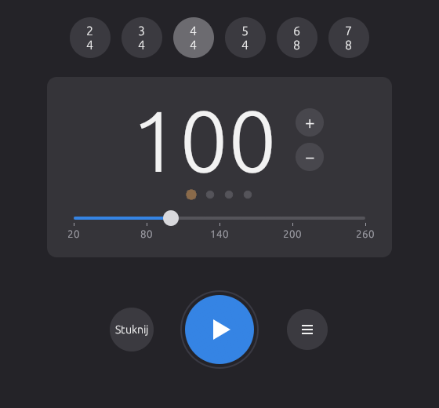
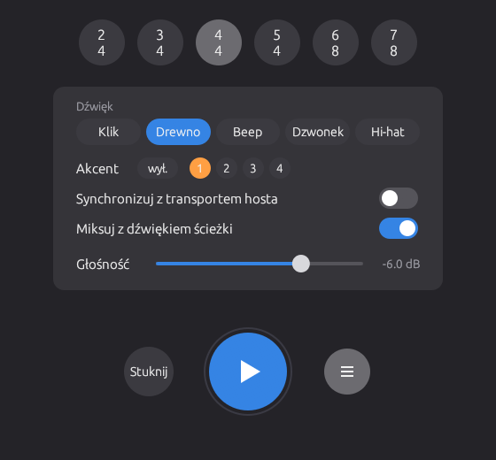

# Metro

[English version](README.md)

Prosty metronom jako wtyczka **VST3 / CLAP** dla Linuksa (Ardour, Reaper i inne), napisany w Rust
z użyciem [nice-plug](https://codeberg.org/RustAudio/nice-plug) i egui. Działa też jako samodzielny program.

<p>
  
  
</p>

## Funkcje

- metrum: 2/4, 3/4, 4/4, 5/4, 6/8, 7/8
- tempo 20–260 BPM: suwak, przyciski +/−, kółko myszy, **Stuknij** (tap tempo)
- 5 syntezowanych dźwięków: Klik, Drewno, Beep, Dzwonek, Hi-hat
- **akcent na dowolnej mierze** (klik w kropkę miary albo przyciski w opcjach) lub wyłączony
- **synchronizacja z transportem hosta**: klik startuje z odtwarzaniem/nagrywaniem, trzyma tempo
  projektu i siatkę taktów (dla metrum x/8 klik pada co ósemkę)
- **miksowanie z dźwiękiem ścieżki**: włączone dodaje klik do sygnału ścieżki, wyłączone daje
  sam klik, a własny dźwięk ścieżki jest wyciszany
- wszystkie ustawienia są parametrami wtyczki: zapisują się w projekcie i można je automatyzować
- interfejs po polsku i po angielsku, wybierany z locale systemu (`LC_ALL` → `LC_MESSAGES` →
  `LANG`); można wymusić przez `METRO_LANG=pl` albo `METRO_LANG=en`

## Pobieranie

Gotowe paczki (wtyczki + samodzielny program + `README.txt` z instrukcją instalacji) są na stronie
[Releases](https://github.com/greblus/metro/releases), budowane przez GitHub Actions. Wersje z każdego
commita są dostępne jako artefakty workflow [Build](https://github.com/greblus/metro/actions).

## Budowanie i instalacja

Wymagany Rust (stable).

```sh
cargo xtask install
```

Buduje wtyczki i kopiuje je do `~/.vst3/Metro.vst3` oraz `~/.clap/Metro.clap`.
Po aktualizacji uruchom DAW ponownie, a w razie potrzeby przeskanuj wtyczki.

Same paczki (bez instalacji) trafiają do `target/bundled/`:

```sh
cargo xtask bundle metro --release
```

Samodzielna aplikacja (JACK/ALSA; `--help` pokazuje opcje audio, np. `-b jack` / `-b alsa`):

```sh
cargo run --release --features standalone
```

W wersji samodzielnej opcje działające tylko w DAW (synchronizacja z hostem, miksowanie ze ścieżką)
są ukryte. Pod PipeWire program gra na domyślne wyjście systemu; inne wyjście (interfejs USB, HDMI…)
wybierzesz w menu w wierszu **Wyjście** i zostanie zapamiętane. `-b jack` przełącza na JACK.

## Nagrywanie kliku

DAW nagrywa **wejście** ścieżki, czyli sygnał przed wtyczkami. Żeby nagrać klik:

**Reaper:** Metro na ścieżce, prawy klik na przycisku nagrywania:
**Record: output → Record: output (stereo)** oraz **Monitor input**
(nie „tape auto style”, bo ten wycisza ścieżkę podczas nagrywania).

**Ardour:** Metro na szynie audio, wyjście szyny podłączone do wejścia ścieżki nagrywającej.
Na wejściu tej ścieżki **nie** zostawiaj jednocześnie połączenia z kartą dźwiękową (`capture_*`):
w połączeniu z backendem JACK na PipeWire skutkowało to nagrywaniem ciszy. Alternatywa bez
nagrywania: zaznacz zakres i użyj *Consolidate/Bounce range (with processing)*.

W obu przypadkach najwygodniej włączyć **Synchronizuj z transportem hosta**.

## Uwagi

- GUI działa przez X11 (na Waylandzie przez XWayland), bo tak osadzają okna wtyczek VST3/CLAP
  Ardour i Reaper.

## Licencja

[ISC](LICENSE), tak samo jak [nice-plug](https://codeberg.org/RustAudio/nice-plug).
